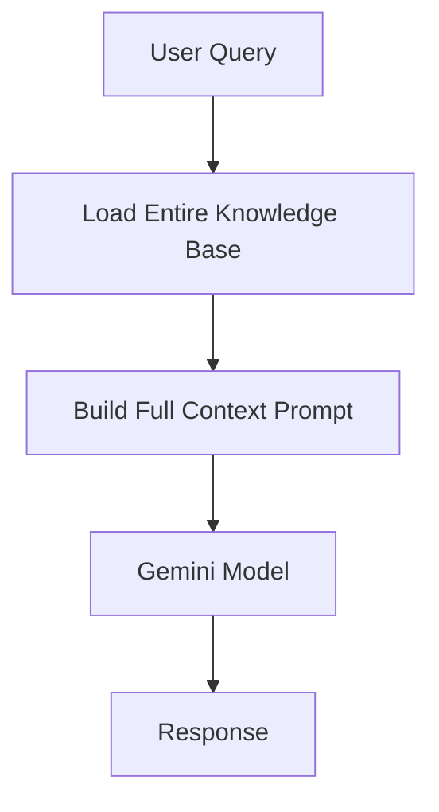
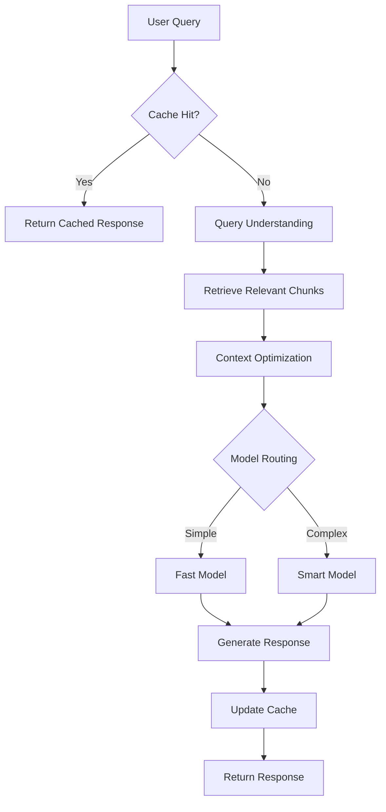

# 🚀 Vertex Token Optimization Lab

> **Stop paying for context you don't need.**  
> A hands-on lab demonstrating how to reduce LLM inference costs through context optimization, Retrieval-Augmented Generation (RAG), model routing, and response caching using Google Gemini on Vertex AI.

---

## 📌 Overview

Large Language Model (LLM) applications can become expensive as they scale. A common anti-pattern is sending the entire knowledge base with every request, even when only a small portion of the context is relevant.

This project demonstrates practical techniques to optimize GenAI inference by reducing unnecessary context, retrieving relevant information, routing requests to appropriate models, and caching repeated queries.

The lab compares a **baseline full-context implementation** against an optimized inference pipeline and measures token usage, estimated cost, latency, and savings.

### Optimization strategies

- **Baseline inference** – Send the entire knowledge base to the model.
- **Retrieval-Augmented Generation (RAG)** – Retrieve only relevant document chunks.
- **Context optimization** – Reduce unnecessary information in prompts.
- **Model routing** – Route simple questions to a faster, cost-efficient model and complex questions to a more capable model.
- **Response caching** – Reuse responses for repeated queries.
- **Benchmarking** – Compare token consumption, estimated cost, and latency.

---

## 🏗️ Architecture

### Baseline Architecture

The baseline implementation sends the complete knowledge base with every user query.



### Optimized Architecture

The optimized pipeline retrieves relevant context, selects an appropriate model, and checks whether the response can be served from cache.



---

## ✨ Features

| Feature | Description |
|---|---|
| Full-context baseline | Establishes the cost of sending all available documents |
| Document chunking | Breaks documents into smaller retrievable units |
| Semantic retrieval | Retrieves relevant knowledge chunks for a given query |
| RAG pipeline | Builds prompts using relevant context instead of the entire corpus |
| Model routing | Selects a model based on query complexity |
| Query caching | Avoids repeated inference for identical normalized queries |
| Token tracking | Tracks input, output, and total token consumption |
| Cost estimation | Estimates inference cost based on configured model pricing |
| Benchmarking | Compares baseline and optimized approaches |
| Latency tracking | Measures request execution time |
| Savings analysis | Calculates token and estimated cost reductions |

---

## 🧰 Technology Stack

- **Python**
- **Google Cloud Vertex AI**
- **Google Gemini**
- **Google Gen AI SDK**
- **Retrieval-Augmented Generation (RAG)**
- **Semantic search / embeddings**
- **Document chunking**
- **Caching**
- **Token and cost analytics**

---

## 📂 Project Structure

```text
vertex-token-optimization-lab/
│
├── documents/
│   ├── backup_policy.txt
│   ├── disaster_recovery.txt
│   ├── kubernetes_policy.txt
│   ├── security_policy.txt
│   └── infrastructure_policy.txt
│
├── results/
│   └── benchmark_results.json
│
├── src/
│   ├── baseline.py
│   ├── optimized.py
│   ├── retrieval.py
│   ├── cache.py
│   ├── model_router.py
│   └── cost_engine.py
│
├── .env.example
├── requirements.txt
└── README.md
```

> The structure above represents the logical components of the lab. Adjust filenames to match the actual repository structure.

---

## 🔄 How It Works

### 1. Baseline: Full Context

The baseline implementation sends the entire knowledge base to the LLM for every query.

```text
User Query
    +
All Knowledge Base Documents
    ↓
Full Prompt
    ↓
Gemini
    ↓
Response
```

This approach is simple but inefficient because every request consumes tokens for potentially irrelevant information.

---

### 2. Retrieval-Augmented Generation (RAG)

The optimized pipeline divides documents into smaller chunks and retrieves the most relevant chunks based on the query.

```text
Documents
    ↓
Chunking
    ↓
Chunk Index
    ↓
User Query
    ↓
Retrieval
    ↓
Top-K Relevant Chunks
    ↓
Optimized Context
    ↓
LLM
```

Instead of sending the entire knowledge base, the model receives only the context needed to answer the question.

---

### 3. Intelligent Model Routing

Not every question requires the same model capability.

The lab implements rule-based model routing to select a model based on query complexity.

| Query Type | Routing Strategy |
|---|---|
| Simple factual question | Fast, cost-efficient model |
| Complex technical question | More capable model |
| Architecture or trade-off analysis | Smart model |

This helps avoid using expensive model capabilities for simple tasks.

---

### 4. Response Caching

Repeated requests can be served without invoking the model again.

```text
User Query
    ↓
Normalize Query
    ↓
Generate Cache Key
    ↓
Cache Lookup
   ↙     ↘
 HIT      MISS
  ↓        ↓
Cached    LLM
Response   ↓
         Cache
          ↓
       Response
```

The current implementation uses a normalized query and a SHA-256 hash to generate the cache key.

Cache hits eliminate the need for a new model inference for that request.

> **Production consideration:** A production cache should also consider model version, prompt version, knowledge base version, tenant, authorization scope, and cache expiration.

---

## 📊 Benchmark Results

A fresh benchmark was conducted using **4 test queries**, with caching bypassed to compare inference optimization rather than cache-hit performance.

### Results

| Metric | Baseline | Optimized |
|---|---:|---:|
| Total Tokens | 17,825 | 3,052 |
| Input Tokens | 16,552 | 2,254 |
| Estimated Cost | $0.008594 | $0.001711 |
| Average Latency* | 20.30 sec | 21.55 sec |

\* Latency for the fourth benchmark query.

### Improvements

| Metric | Improvement |
|---|---:|
| Total token reduction | **82.9%** |
| Input token reduction | **86.4%** |
| Estimated cost reduction | **80.1%** |

### Token Reduction

```text
Baseline    ████████████████████████████████████  17,825
Optimized  ██████                                 3,052
```

### Estimated Cost Reduction

```text
Baseline    $0.008594
Optimized  $0.001711
Savings    ~$0.006883 per benchmark request
```

The optimized pipeline significantly reduces token consumption and estimated inference costs.

However, optimization does not necessarily improve latency. Retrieval, processing, and routing introduce additional overhead, and the benchmark showed that latency can increase even when token consumption and estimated cost decrease.

> These results are based on a small synthetic benchmark and configured pricing assumptions. They are illustrative and should not be interpreted as production cost guarantees.

---

## 🧪 Benchmark Methodology

The benchmark evaluates the same set of questions against two approaches.

### Baseline

- Load the complete knowledge base.
- Construct a full-context prompt.
- Invoke the configured Gemini model.
- Record token usage, estimated cost, and latency.

### Optimized

- Retrieve relevant document chunks.
- Construct a reduced context prompt.
- Select a model using routing rules.
- Invoke the model.
- Record token usage, estimated cost, and latency.

### Metrics

- Input tokens
- Output tokens
- Total tokens
- Estimated inference cost
- Latency
- Token reduction percentage
- Cost reduction percentage

The benchmark bypasses the cache to avoid artificially inflating optimization savings through cached responses.

---

## ⚙️ Prerequisites

Before running the lab, ensure you have:

- Python 3.10+
- Google Cloud project
- Vertex AI API enabled
- Google Cloud authentication configured
- Access to the configured Gemini models

Authenticate with Google Cloud:

```bash
gcloud auth application-default login
```

Set your Google Cloud project:

```bash
gcloud config set project YOUR_PROJECT_ID
```

---

## 🚀 Getting Started

### 1. Clone the repository

```bash
git clone https://github.com/YOUR_USERNAME/vertex-token-optimization-lab.git

cd vertex-token-optimization-lab
```

### 2. Create a virtual environment

```bash
python -m venv .venv
```

Activate it.

**Windows**

```powershell
.venv\Scripts\Activate.ps1
```

**Linux / macOS**

```bash
source .venv/bin/activate
```

### 3. Install dependencies

```bash
pip install -r requirements.txt
```

### 4. Configure Google Cloud

Ensure your Google Cloud project is configured and Vertex AI is enabled.

```bash
gcloud auth application-default login
gcloud config set project YOUR_PROJECT_ID
```

### 5. Configure environment variables

Create a `.env` file based on `.env.example`.

Example:

```env
GOOGLE_CLOUD_PROJECT=your-project-id
GOOGLE_CLOUD_LOCATION=us-central1

FAST_MODEL=gemini-3.5-flash-lite
SMART_MODEL=gemini-3.8-flash
```

> Model availability and names may vary by region and Google Cloud project. Verify that the configured models are available in your Vertex AI environment.

---

## ▶️ Running the Lab

Run the baseline implementation to establish the full-context benchmark.

```bash
python baseline.py
```

Run the optimized implementation.

```bash
python optimized.py
```

Run the benchmark to compare the two approaches.

```bash
python benchmark.py
```

> Update the commands above to match the actual entry-point filenames in your repository.

---

## 💡 Example Queries

The synthetic knowledge base contains cloud infrastructure, security, backup, disaster recovery, and Kubernetes policies.

Example questions:

```text
What is the backup retention policy?
```

```text
What is the disaster recovery RTO and RPO?
```

```text
What are the Kubernetes resource requirements?
```

```text
What are the infrastructure security requirements?
```

```text
How should production infrastructure be configured?
```

The benchmark demonstrates how query-specific retrieval can reduce the amount of information sent to the model.

---

## 🔍 Key Learnings

### 1. Context is a cost center

Every unnecessary token sent to a model increases the cost of inference. Large prompts are not automatically better prompts.

### 2. RAG is an optimization strategy

Retrieval is not only about grounding responses. It can also reduce the inference footprint by limiting context to relevant information.

### 3. Model selection matters

A simple factual query does not always require the most capable model available.

### 4. Cache hits can eliminate inference

Repeated requests can be served without additional model execution, but cache invalidation and correctness are critical.

### 5. Token savings do not guarantee latency savings

Retrieval, chunking, query processing, and routing introduce overhead. Optimize based on the metric that matters to your workload.

### 6. Measure before making claims

Evaluate token consumption, cost, response quality, latency, and reliability together.

---

## ⚠️ Limitations

This lab is intentionally simplified to demonstrate core optimization techniques.

- Uses a synthetic knowledge base.
- Uses a small benchmark dataset.
- Cost is based on configured pricing assumptions.
- Retrieval quality depends on chunking and retrieval parameters.
- Top-K retrieval does not guarantee source diversity.
- Model routing uses simplified rules.
- Cache keys currently focus on normalized query text.
- Cached responses require invalidation when underlying knowledge or prompt logic changes.
- Token savings may come from multiple optimization techniques combined.
- Latency can increase despite reduced token usage.
- The benchmark is not statistically significant or representative of all workloads.

For example, a top-K retrieval configuration may return multiple chunks from the same document rather than diverse sources. In production, retrieval should be evaluated for relevance, source coverage, diversity, and answer quality.

---

## 🏭 Production Considerations

Before implementing these techniques in production, consider:

- Semantic retrieval evaluation
- Hybrid search
- Reranking
- Context relevance scoring
- Dynamic context budgets
- Model routing based on structured intent and complexity
- Cache expiration and invalidation
- Cache versioning
- Tenant-aware cache isolation
- Prompt versioning
- Knowledge base versioning
- Model version tracking
- Observability and tracing
- Token budgets
- Cost budgets and alerts
- Quality evaluation
- Hallucination monitoring
- Security and authorization-aware retrieval
- Rate limiting and retry handling

---

## 🎯 Project Goals

This project aims to demonstrate that GenAI applications can be made more efficient without blindly increasing model capability or context size.

The goal is to build a more intelligent inference pipeline:

```text
Retrieve Less
     ↓
Send Less Context
     ↓
Choose the Right Model
     ↓
Reuse Safe Responses
     ↓
Measure Everything
     ↓
Reduce Cost
```

---

## 📈 Future Enhancements

- [ ] Vector database integration
- [ ] Embedding-based semantic retrieval
- [ ] Hybrid search
- [ ] Reranking
- [ ] Adaptive Top-K retrieval
- [ ] Dynamic context budgeting
- [ ] Advanced model routing
- [ ] Semantic caching
- [ ] Cache invalidation and versioning
- [ ] Retrieval quality evaluation
- [ ] Automated benchmark suite
- [ ] Cost dashboard
- [ ] LangSmith or OpenTelemetry integration
- [ ] Multi-model benchmarking
- [ ] Production-ready API layer
- [ ] Quality and hallucination evaluation

---

## 🤝 Contributing

Contributions, ideas, and improvements are welcome.

If you would like to extend this lab:

1. Fork the repository.
2. Create a feature branch.
3. Add your optimization or evaluation technique.
4. Run the benchmark.
5. Submit a pull request.

---

## 👨‍💻 Author

**Vivek Singh**

Cloud & Platform Architect | Azure | Multi-Cloud | GenAI | Kubernetes | DevOps

Exploring practical ways to build efficient, scalable, and cost-aware AI systems.

---

## ⭐ Support the Project

If you find this project useful:

- ⭐ Star the repository
- 🍴 Fork it
- 💡 Suggest improvements
- 🛠️ Contribute optimization techniques

---

## 📜 Disclaimer

This project is intended for educational and experimentation purposes.

Benchmark results are based on a synthetic dataset, a limited number of queries, and configured pricing assumptions. Actual costs, performance, latency, and response quality will vary depending on models, regions, workload patterns, retrieval quality, and production implementation.

---

# 🚀 Stop paying for context you don't need.
